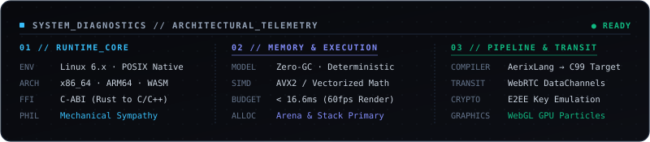
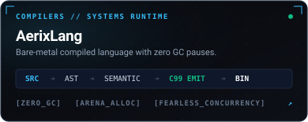
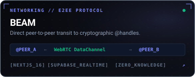
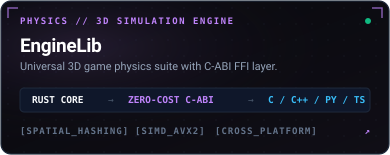
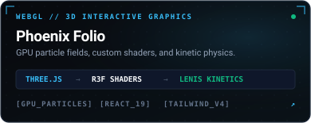
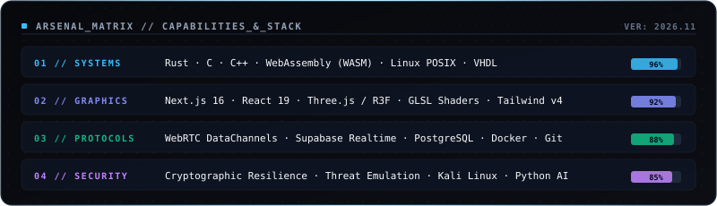
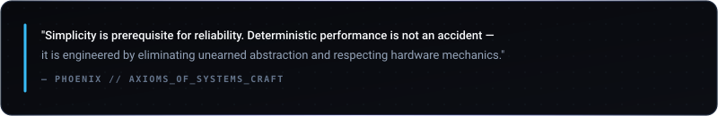
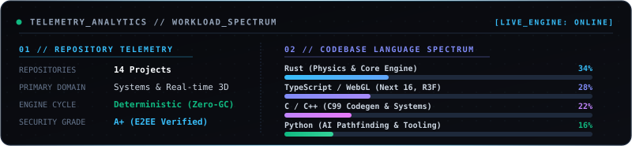

  

 

  

 

### `01` / FLAGSHIP SYSTEMS ARCHITECTURES

<table border="0" cellspacing="0" cellpadding="4" width="100%">
  <tr>
    <td width="50%" align="center">
      
    </td>
    <td width="50%" align="center">
      
    </td>
  </tr>
  <tr>
    <td width="50%" align="center">
      
    </td>
    <td width="50%" align="center">
      
    </td>
  </tr>
</table>

 

### `02` / ARSENAL & CAPABILITIES MATRIX

  

 

### `03` / ENGINEERING AXIOMS

  

 

### `04` / TELEMETRY & RUNTIME ANALYTICS

  

 

### `05` / SECURE COMMS & DIRECT CHANNELS

  
  &nbsp;&nbsp;
  
  &nbsp;&nbsp;
  

 

  2026 © Phoenix // HaxOrWot · Engineered for Deterministic Speed

